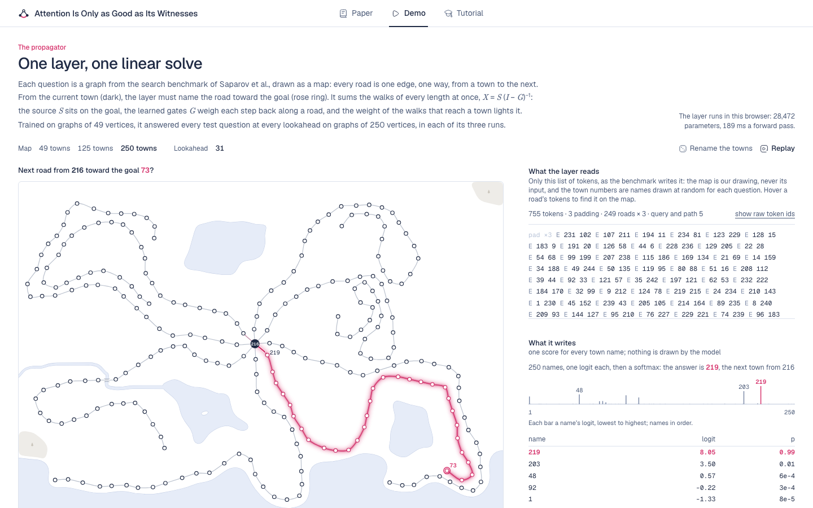

<h1 align="center">Attention Is Only as Good as Its Witnesses</h1>

<p align="center"><b>When Higher-Order Layers Help, and When They Do Not</b></p>

<p align="center">
  <a href="https://neovand.github.io/witnesses/">Project page</a> ·
  <a href="https://neovand.github.io/witnesses/paper">Paper</a> ·
  <a href="https://neovand.github.io/witnesses/attention-witnesses.pdf">PDF</a> ·
  <a href="https://neovand.github.io/witnesses/demo">Demo</a> ·
  <a href="https://neovand.github.io/witnesses/tutorial">Tutorial</a> ·
  <a href="https://youtu.be/3ITb16_glcg">Film</a>
</p>

<p align="center">
  <a href="https://neovand.github.io/witnesses/demo"></a>
</p>

Transformers stop learning graph search as graphs grow, and learn the card game SET only after many distinct questions,
although attention can represent both. The paper reads these failures, and the uneven record of higher-order
attention, from what a layer sums over: each layer it studies computes the partition function of a family of
witnesses (tokens, pairs, walks, subsets) and reads it at a temperature. It proves a size law and a depth law ($L$
layers over two-step walks reach exactly $2^L - 1$ steps, for every $L$) and builds layers on them. One propagator
layer trained on 49-vertex graphs answers every question at every search depth on 250-vertex graphs. The site renders
the paper and a tutorial for students, and runs the trained models in the browser.

## The site

- `/`: the title, the idea, the links, and the propagator's walks on the paper's 250-vertex test question, computed
  at build time and animated one walk length at a time; the abstract, Fig. 1 and four findings in the abstract's words.
- `/paper`: the paper, rendered from `paper/paper.md` (its PDF at `/attention-witnesses.pdf`).
- `/tutorial`: the companion tutorial for students, rendered from `tutorial/tutorial.md` by the same pipeline (its PDF
  at `/attention-witnesses-tutorial.pdf`).
- `/demo`: the propagator, then the pair state and the OR join layer by layer (below).

## The demo

`/demo` has two parts. Each shows what its model reads, the question's tokens exactly as the benchmark writes them
(every `E u v`, `Q start goal`, `P` and the path), linked to the map both ways, and what it writes, one logit for every
town name and their softmax. "Rename the towns" gives every town a new random name and the roads a new order, reruns the
model live and checks that it chooses the same road under its new name.

**The propagator.** One layer that sums every walk of every length with one linear solve, `X = S (I - G)^-1`, from
gates `G` and a source `S` computed on a pair state over vertex names (28,472 parameters, trained on graphs of 49
vertices). It runs in plain TypeScript (`runProp` in `src/lib/search/model.ts`) in a Web Worker, on the benchmark's
test questions at 49, 125 and 250 towns. Each question is drawn as a road map; the walks' weight spreads back from the
goal as the partial sums `Σ_{m ≤ M} S Gᵐ` add the walks one length at a time, then the map holds on the solve and the
chosen road lights. Click a town to make it the goal; hover a road to read its learned gates. The page opens on the
250-town question, computed at build time by the same forward pass, and goes live when the weights (300 KB) arrive.
`/demo?towns=125&question=31` opens another question.

- `static/model/prop_v49.json`: every parameter array, named by its path in the training code.
- `static/model/graphs_v250.json` and `static/maps250/0.json`: the 250-vertex test question of the paper's Fig. 2
  (test question 1 at lookahead 31 of the benchmark's 250-vertex test set) and its map.
- `test-data/reference_prop.json`: the training code's own logits, and per channel the current town's row of `X` and of
  `S`, for 25 questions at 49, 125 and 250 vertices, the gates of every road of the 250-vertex question, and the
  training code's answer to every exported question. `src/lib/search/prop.spec.ts` checks the TypeScript pass against
  them (largest difference 2e-5 in the logits, 3e-6 relative in `X`) and that it answers all 300 + 37 + 1 questions as
  the training code does.

**Layer by layer: the depth law.** The pair state over names trained at 49 vertices (8 summed pair layers, 39,504
parameters) and the OR join (one pair layer repeated K times, 24,896 parameters), each layer summing over the
two-step walks through every middle town. The map and the pair state's read-out follow one playhead, layer by layer;
the walk drives to the goal, one forward pass a step. Click a town to make it the goal, drag between towns to build a
road, click a road to close it. `/demo?q=1` to `?q=300` opens a 49-town question; `/demo?size=125&q=1` to `?q=37` the
OR join on 125 towns, `&k=` for its iterations.

- `static/model/pairn_v49.json`, `static/model/orjoin_v49.json`: their parameter arrays.
- `static/model/graphs_v49.json`, `static/model/graphs_v125.json`: 300 test questions at 49 vertices (12 per lookahead
  1 to 24, and 12 random graphs) and 37 at 125; `static/maps/` and `static/maps125/`: their maps, laid out offline.
  Every road on a map is an edge of its question (`src/lib/search/map.spec.ts`).
- `test-data/reference_v49.json`, `test-data/reference_orjoin.json`: the training code's outputs, checked by
  `model.spec.ts` (below 1e-3) and `orjoin.spec.ts` (below 1e-4).

## Run it locally

```bash
pnpm install
pnpm dev
```

Then open <http://localhost:5173/>.

Checks:

```bash
pnpm check
pnpm lint
nice -n 19 pnpm vitest --run --maxWorkers=2
```

The paper and the tutorial are copied in from their Markdown sources, with their figures and their PDFs:

```bash
PAPER_SRC=/path/to/the/paper node scripts/sync-paper.mjs           # paper.md, refs.bib, figures, the PDF
TUTORIAL_SRC=/path/to/the/tutorial node scripts/sync-tutorial.mjs  # tutorial.md, refs.bib, its figures, the PDF
node paper/build-tex.ts --pdf     # the paper's LaTeX from the same source: paper/tex/main.pdf (needs tectonic)
```

The build stops if a reference is unresolved, or if an abstract sentence the project page quotes is gone.

The film: set `FILM_URL` in `src/lib/site.ts` to its URL and the Film link appears on the project page.

Scripts:

```bash
node scripts/depth.ts      # the depth table: read-out accuracy after each layer, by lookahead
node scripts/record.ts     # the recording the second part of the demo opens on
PLAYWRIGHT=/path/to/node_modules/playwright/index.mjs node scripts/shots.mjs   # screenshots into docs/, the social card
PLAYWRIGHT=/path/to/node_modules/playwright/index.mjs node scripts/maps.mjs    # every question's map, in the browser
```

## Reproducing the paper

[`research/`](research/) holds the training code, the loader for the search benchmark's test sets, the Lean files and
the results behind every figure and table; [`research/README.md`](research/README.md) maps each theorem, figure and
table to its folder. The scripts that draw the paper's five figures, and the data they read, are in
[`paper/figures/`](paper/figures/).

## Repository

| Path              | What it holds                                                                          |
| ----------------- | -------------------------------------------------------------------------------------- |
| `src/routes/`     | the site: the project page, the paper (`paper/`), the tutorial, the demo (`demo/`)     |
| `src/lib/search/` | the models' forward passes, the benchmark's input format, the maps and the demo panels |
| `src/lib/paper/`  | the Markdown pipeline that renders the paper as HTML and LaTeX                         |
| `paper/`          | the paper's source, its figure scripts and figures (`figures/out/`), the LaTeX build   |
| `research/`       | training code, benchmark loaders, Lean proofs and results for every figure and table   |
| `tutorial/`       | the tutorial's source and its own figures                                              |
| `static/`         | the exported models and questions, their maps, the paper's PDF and the social card     |

## Citation

```bibtex
@misc{mohsenvand2026witnesses,
  title  = {Attention Is Only as Good as Its Witnesses: When Higher-Order Layers Help, and When They Do Not},
  author = {Mohsenvand, Mostafa},
  year   = {2026},
  url    = {https://github.com/NeoVand/witnesses}
}
```

## License

Code and text are licensed under the Apache License 2.0 ([`LICENSE`](LICENSE)).
